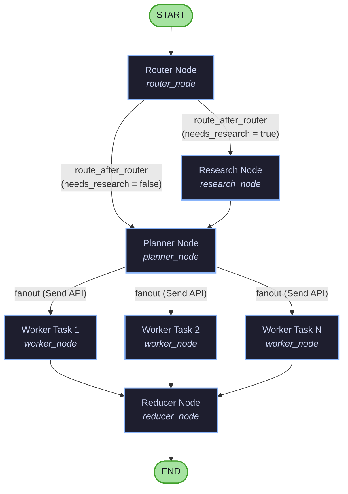

# 🚀 AI Technical Blog Generator

**An asynchronous, multi-agent blog generation engine powered by LangGraph, FastAPI, and Tavily.**

[Features](#-key-features) • [Graph Architecture](#-full-graph-architecture) • [Quickstart](#-quickstart) • [Configuration](#%EF%B8%8F-configuration) • [API Reference](#-api-reference)

## 📌 Overview

**AI Technical Blog Generator** transforms high-level technical topics into publication-ready, deeply researched Markdown articles. Rather than generating long text in a single LLM call, it uses a **map-reduce LangGraph state graph**:

1. **Routes** queries based on research requirements.
2. **Retrieves** real-time data using the Tavily Search API.
3. **Plans** structured, non-overlapping section outlines.
4. **Drafts** sections in parallel across isolated worker nodes.
5. **Reduces** sections into a polished Markdown document.

## ✨ Key Features

* 🧠 **Dynamic Research Routing**: Classifies requests into `closed_book` (evergreen), `hybrid`, or `open_book` (latest news/rankings) modes and extracts web snippets automatically.
* ⚡ **Map-Reduce Parallelism**: Outlines sections and drafts them concurrently using LangGraph's `Send` API bounded by configurable worker concurrency limits.
* 🔄 **Multi-Provider Support**: Seamlessly swap backends between **Groq** (`openai/gpt-oss-20b`) and **Google Gemini** (`gemini-2.5-flash`).
* 🛡️ **Self-Healing Fallbacks**: Automatic retry engine (`invoke_with_retry`) handling rate limits (HTTP 429), quota limits, tool-parsing failures, and fallback schema normalization.
* 🌐 **Asynchronous REST API + UI**: Non-blocking background job queue served alongside an integrated web frontend (`/static`) with Markdown live preview and single-click file downloads.

## 🏗️ Full Graph Architecture

The workflow is built as a stateful graph using **LangGraph**. The state (`GraphState`) flows through dynamic conditional routing, parallel execution fan-out, and reducer fan-in operations.



### Graph Components & Node Mechanics

| Node / Edge | Function | Behavior & Output |
| :--- | :--- | :--- |
| `START` | Entry Point | Receives initial `GraphState` containing topic and configuration options. |
| **`router`** | Topic Classification | Calls LLM to decide mode (`closed_book`, `hybrid`, `open_book`) and generates search queries. |
| **`route_after_router`** | Conditional Edge | Evaluates `state["needs_research"]` to branch to `research` or skip directly to `planner`. |
| **`research`** | Web Evidence Retrieval | Queries Tavily API for up to `MAX_RESEARCH_QUERIES`, returning formatted `EvidenceItem` snippets. |
| **`planner`** | Outline Generation | Generates structured `Plan` containing sections, word counts, bullets, and constraints. |
| **`fanout`** | Map Phase (`Send` API) | Dynamically spawns a `worker_node` instance for each section task in parallel. |
| **`worker`** | Content Generation | Concurrently drafts individual Markdown sections according to section target words and bullets. |
| **`reducer`** | Reduce Phase | Sorts finished sections by ID, joins them under `# {blog_title}`, and yields the final Markdown output. |
| `END` | Execution Complete | Returns final state to FastAPI executor; output file is saved to disk (`outputs/{job_id}.md`). |

### State Schema (`GraphState`)

```python
class GraphState(TypedDict, total=False):
    topic: str
    mode: str
    needs_research: bool
    queries: list[str]
    evidence: list[EvidenceItem]
    plan: Optional[Plan]
    sections: Annotated[list[tuple[int, str]], operator.add]  # Appended in parallel
    merged_md: str
    final: str
```

## 📁 Project Structure

```
.
├── main.py              # FastAPI server, LangGraph workflow, & LLM configuration
├── static/
│   └── index.html       # Web user interface
├── outputs/             # Generated Markdown files ({job_id}.md)
├── .env.example         # Template for environment configuration
├── requirements.txt     # Python dependencies
└── README.md            # Project documentation
```

## 🚀 Quickstart

### 1. Clone the Repository

```bash
git clone https://github.com/your-username/ai-blog-generator.git
cd ai-blog-generator
```

### 2. Set Up Virtual Environment

```bash
python -m venv venv

# On Windows (PowerShell):
.\venv\Scripts\Activate.ps1

# On macOS/Linux:
source venv/bin/activate
```

### 3. Install Dependencies

```bash
pip install fastapi uvicorn pydantic python-dotenv langgraph langchain-core langchain-groq langchain-google-genai tavily-python
```

### 4. Configure Environment Variables

Create a `.env` file in the project root:

```env
# LLM Provider: "groq" or "gemini"
LLM_PROVIDER=groq

# API Keys
GROQ_API_KEY=your_groq_api_key_here
GOOGLE_API_KEY=your_google_api_key_here
TAVILY_API_KEY=your_tavily_api_key_here

# System Settings (Optional)
GROQ_MODEL=openai/gpt-oss-20b
GEMINI_MODEL=gemini-2.5-flash
MAX_TOKENS=4096
ENABLE_RESEARCH=true
MAX_RESEARCH_QUERIES=3
MAX_WORKERS=2
HOST=127.0.0.1
PORT=8000
```

### 5. Launch the Application

```bash
python main.py
```

Navigate to **`http://127.0.0.1:8000`** in your browser to access the frontend generator interface, or open **`http://127.0.0.1:8000/docs`** for the OpenAPI documentation.

## ⚙️ Configuration

| Variable | Default | Description | 
| ----- | ----- | ----- | 
| `LLM_PROVIDER` | `groq` | Selected provider (`groq` or `gemini`). | 
| `GROQ_MODEL` | `openai/gpt-oss-20b` | Model used when provider is set to `groq`. | 
| `GEMINI_MODEL` | `gemini-2.5-flash` | Model used when provider is set to `gemini`. | 
| `MAX_TOKENS` | `4096` | Max tokens generated per request (Groq). | 
| `ENABLE_RESEARCH` | `true` | Toggle web search functionality via Tavily. | 
| `MAX_RESEARCH_QUERIES` | `3` | Max web queries per generation job (range: 1-5). | 
| `MAX_WORKERS` | `2` | Max concurrent worker tasks executing in parallel (range: 1-4). | 
| `HOST` | `127.0.0.1` | Network interface host address. | 
| `PORT` | `8000` | Port used to run Uvicorn server. | 

## 📡 API Reference

### `GET /api/health`

Checks backend connectivity and provider readiness.

**Response:**

```json
{
  "status": "ok",
  "provider": "groq",
  "max_workers": 2,
  "research_configured": true
}
```

### `POST /api/generate`

Queues a blog generation background job.

**Request:**

```json
{
  "topic": "Event-Driven Architecture in Python with Kafka and FastAPI",
  "research": true
}
```

**Response:**

```json
{
  "job_id": "4b6a82d0-1c39-4d64-a67b-12d9cf82903e",
  "status": "queued"
}
```

### `GET /api/jobs/{job_id}`

Returns current progress (`queued`, `running`, `completed`, `failed`) and the compiled Markdown content once finished.

### `GET /api/jobs/{job_id}/download`

Downloads the output file directly as `text/markdown`.

## 📜 License

Distributed under the MIT License. See `LICENSE` for more information.
